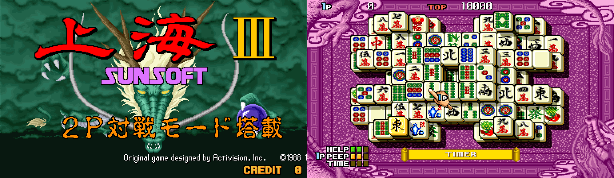

# Shanghai III for MiSTer

A MiSTer FPGA core for **Shanghai III** (Sunsoft, 1993), the arcade mahjong-solitaire game. The core re-creates the original board in hardware logic:

- 68000 CPU
- Sunsoft's GA9201 graphics blitter
- YM2149 music chip
- OKI M6295 sample chip

It was checked against MAME and against a real Shanghai III PCB: boot, picture, gameplay and sound balance. The core was created with the assistance of AI tooling.

**Status: v1.0.0.** Tested on a DE10-Nano with a CRT (15 kHz analog) and with HDMI.

## Supported set

| Game | MAME set | MRA | ROM zips |
| --- | --- | --- | --- |
| Shanghai III (Japan) | `shangha3j` | `Shanghai III (Japan).mra` | `shangha3j.zip`, plus its parent `shangha3.zip` if your set is split |

ROMs are not included. Use a MAME 0.289 set (`mame -verifyroms shangha3j`). Split, non-merged and merged sets all work: the MRA looks in `shangha3j.zip` first, then `shangha3.zip`.

The other sets (`shangha3`, `shangha3u`, `shangha3up`) use different program ROMs and haven't been tested.

## Installation

1. Copy `releases/Shanghai3_YYYYMMDD.rbf` to `/media/fat/_Arcade/cores/`. If you're updating, remove any older `Shanghai3_*.rbf` from there.
2. Copy `releases/Shanghai III (Japan).mra` to `/media/fat/_Arcade/`.
3. Copy the ROM zip(s) to `/media/fat/games/mame/`.
4. Start the game from the **Arcade** menu.

The release zip on the GitHub Releases page is laid out like the SD card. You can copy its `_Arcade` folder onto the root of the SD card instead of steps 1 and 2.

Requires an SDRAM module: the game's ROMs are kept in SDRAM. Any size works.

## What to expect

- **The game tests itself for about 12 seconds after loading**, as the arcade board does: a black screen, then "ROM 1 CHECK OK", "ROM 2 CHECK OK", "VIEW WORK CHECK OK", "COLOR RAM CHECK" and "ADPCM CHECK OK".
- The **green stripes during COLOR RAM CHECK** are correct. The real board shows them too, because it changes colors mid-frame. (MAME shows solid flashes there.)
- The attract mode is silent; the music starts in the demo game.

## Controls

| Game | MiSTer default (pad) |
| --- | --- |
| Joystick (moves the hand) | D-pad / stick |
| Button 1 (pick a tile) | A |
| Button 2 | B |
| Start | Start |
| Coin | Select |
| Service (adds a credit) | R |

Two players are supported (second controller), including the 2-player modes.

## OSD options

- **Aspect ratio:** Original (4:3), Full Screen, or the custom ratios set in MiSTer.ini.
- **Scandoubler Fx:** None, HQ2x, CRT 25 / 50 / 75 %.
- **OKI (drums/FX):** the balance between the board's two sound chips; see [Sound](#sound) below.
  - **PCB** (default) is the balance measured against a real Shanghai III board.
  - **OKI+ / OKI++** bring the drums and effects forward by 3 / 6 dB; **OKI− / OKI−−** make them 3 / 6 dB less pronounced.
  - The setting cycles PCB → OKI+ → OKI++ → OKI−− → OKI− → PCB.
- **Orientation:** Horizontal, Vertical CW, Vertical CCW. The vertical settings rotate the HDMI picture through the MiSTer scaler, for vertical (TATE) monitors. The analog/CRT output is never rotated.
- **CRT Adjust** (page): picture geometry for analog CRTs, by rmonic79.
  - Turn it **On**, then set:
    - **H-Size** in 1 % steps, from −12 to +10 %
    - **H-Position** in 6-pixel steps
    - **V-Shift** in 1-line steps
  - Sync is never moved, so the CRT stays locked while you adjust.
  - It needs Scandoubler Fx = None. While it's On, HDMI follows the adjustment too; with it Off, the video passes through untouched.
- **DIP Switches:** see below. Press Reset after changing them: the game reads some of them (Flip Screen, for one) only during its self-test.
- **Service Mode:** the board's test switch, for the game's service menu.
- **Pause when OSD is open:** On by default. Opening the menu freezes the game and silences it; closing the menu resumes exactly where it stopped.
- **Reset**, **Reset and close OSD**.

## Sound

The arcade board makes its sound with two chips, mixed together on the board. The core re-creates both.

**YM2149: the music.** A Yamaha sound chip (a close relative of General Instrument's AY-3-8910) that generates simple tones: three square-wave voices plus noise. In Shanghai III it plays the melody, the harmony and the bass line.

**OKI M6295: drums and sound effects.** "OKI" is Oki Electric, the Japanese company that made the MSM6295. Instead of generating tones, it plays back short recorded sounds stored in a ROM on the board (ADPCM, a compressed digital audio format), up to four at a time. It was common in early-'90s arcade games for voices, drums and effects. In Shanghai III it plays:

- the music's drums, including the deep kick-drum thump that gives the music most of its low end;
- the sound effects: picking a tile, the special sound when a pair of season or flower tiles is removed, the jingles.

**The balance option.** The relative volume of the two chips was measured from a recording of a real board, and that's the **PCB** setting. If you'd like the drums and effects more prominent (OKI+, OKI++) or more in the background (OKI−, OKI−−), each step moves them 3 dB against the music. The music moves the opposite way by half as much, so the overall loudness stays about the same. For overall volume, use MiSTer's own volume control.

## DIP switches

| Switch | Settings (default in bold) |
| --- | --- |
| Coin A, Coin B | **1C/1C**, 2C/1C, 3C/1C, 4C/1C, 5C/1C, 1C/2C, 1C/3C, 1C/4C |
| Difficulty | Easy, **Normal**, Hard, Hardest |
| Base Time | 70, **80**, 90, 100 sec |
| Additional Time | 4, **5**, 6, 7 sec |
| Demo Sounds | Off, **On** |
| Flip Screen | **Off**, On |

## Known differences

- **One frame of display delay** compared with MAME: each new picture appears about 17 ms later. The original board's frame buffering isn't documented. The delay isn't noticeable in play.
- The video sync positions are estimates; the picture is centered correctly on the CRTs it was tested on. If yours needs it, use CRT Adjust.

## Building from source

See [docs/DEVELOPMENT.md](docs/DEVELOPMENT.md): Quartus build, simulations, the MAME comparison tools, and how the core was verified. What changed in each version is in [CHANGELOG.md](CHANGELOG.md).

## Credits

- **YoAaronD:** the core.
- **Kyle Lester** (kyledlester): hardware testing; the CRT Adjust glue and the rotation approach come from his Nostradamus core.
- **Umberto Parisi** (rmonic79): CRT Adjust.
- **Jorge Cwik**: fx68k, the 68000 CPU core.
- **Jose Tejada** (jotego): jt49 (YM2149) and jt6295 (OKI M6295).
- **Sorgelig** and the MiSTer contributors: the MiSTer framework and the SDRAM controller.
- **The MAME team:** the `shangha3.cpp` driver by Nicola Salmoria, used as a behavioral reference. No MAME code is in the core.
- **Raki** (ika-musume): the pause-when-OSD-is-open idea, from the CV1000 core.

## License

GPL-3.0-or-later; see [LICENSE](LICENSE). Third-party parts keep their own licenses, listed in [docs/DEVELOPMENT.md](docs/DEVELOPMENT.md#licenses).
